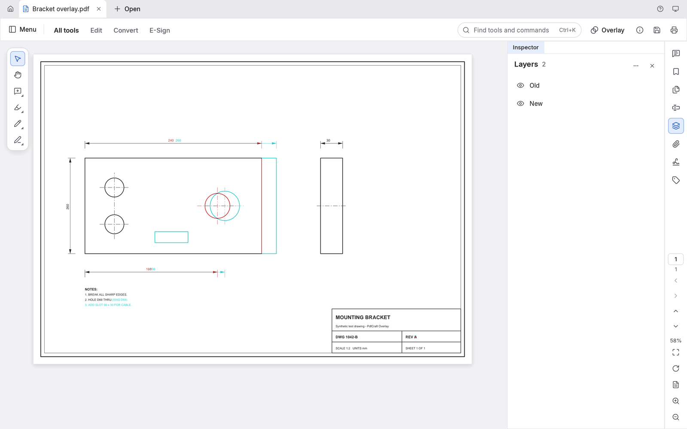

<!-- Modified by the PdfCraft Overlay fork (sefr-14/pdfcraft); changes are recorded in its Git history. -->
> [!IMPORTANT]
> **This is PDF Overlay, an unofficial fork of [PdfCraft](https://github.com/storytold/pdfcraft), originally developed by the ArtCraft team.**
> It is based on PdfCraft 0.14.0 (upstream tag `v0.14.0`, 5a78b22) and adds an overlay compare for revisions of drawing sets,
> plus tools for reviewing engineering drawings. It is not made, endorsed or supported by the ArtCraft team or the PdfCraft
> project. See [About this fork](#about-this-fork).

  

<h1 align="center">PDF Overlay</h1>

  <b>View PDFs and compare revisions of engineering drawings: overlay two drawing sets in two colours, then measure and review them.</b> 
  An unofficial fork of the open-source PdfCraft PDF workbench by the ArtCraft team, built in pure Rust, with everything PdfCraft does. 
  Windows 11 x64 (this fork's builds) · upstream PdfCraft also runs on macOS, Linux, FreeBSD and the web

  
  
  
  

  <a href="https://github.com/sefr-14/pdfcraft/issues"><b>Report a problem with this fork</b></a> ·
  <a href="https://github.com/storytold/pdfcraft"><b>Upstream PdfCraft</b></a>

 

  
   
  Overlay compare: two revisions of a (synthetic) drawing in one PDF, unchanged lines in black, Old in red, New in cyan, each its own layer.

---

## About this fork

This repository, [sefr-14/pdfcraft](https://github.com/sefr-14/pdfcraft), is an unofficial fork of
[storytold/pdfcraft](https://github.com/storytold/pdfcraft), based on PdfCraft by the ArtCraft team.
It is not made, endorsed or supported by them, so report problems with the fork here, not upstream.

Translations: upstream PdfCraft's labels keep all their translations, with the product name shown as
PDF Overlay in every language. This fork's own labels are kept in English and Spanish; in other
languages they may show in English.

**What it adds: Overlay compare.** The Overlay button in the mode bar (also All tools › Compare
files › Overlay two revisions) compares two revisions of a drawing set. A six-step wizard pairs the
sheets, including inserted, deleted and moved ones; matches sheet sizes; aligns the revisions from
reference points clicked on the drawings; previews the result; and writes one new PDF. In it both
revisions stay vector drawings, each in its own colour, in exactly two layers, **Old** and **New**,
that can be switched on and off separately. The source files are never changed. Before anything is
written, the sources' own layers and annotations are resolved: content a source hides stays hidden,
and anything that can't be decided with certainty is asked about.

- The engine is the `pdfcraft-overlay` crate, [`crates/overlay`](crates/overlay). Its
  [README](crates/overlay/README.md) gives the rules, the checks and the known limitations.
- The wizard is [`crates/ui-egui/src/overlay_ui.rs`](crates/ui-egui/src/overlay_ui.rs).

**Also: Duplicate Tab.** Right-click a document tab and choose **Duplicate Tab** (or run
"Duplicate tab" from the command palette, Ctrl+K / ⌘K) to open a second tab on the same PDF, for
example to read the legend on one sheet while looking at a detail on another. The new tab, named
`Structural Plan.pdf (2)` (then `(3)` and so on), opens at the same page, zoom and scroll position
as the tab it came from. From then on **each tab is navigated independently**: different pages, or
different areas of the same page, can be viewed and navigated in each tab, each with its own page,
scroll position, zoom, panning and Previous view / Next view history. Navigating one tab never
moves the other.

- Both tabs show **one document**: the PDF is not copied or read again. An edit or comment made in
  either tab appears in both, Undo and Redo work on the document's single history from either tab,
  both tabs show the unsaved-changes dot, and Save writes the document once.
- Closing one of the tabs doesn't ask to save while another tab still shows the document: the
  document and its unsaved changes stay open there, and anything still being typed in the closed
  tab goes into the document first. Closing the last tab asks as before. Quit and File › Close all
  ask once per document.
- A file changed on disk reloads in every tab of it, each keeping its own page and zoom.
- Reopening the last session restores each file once, not its duplicates.
- Duplicate Tab is part of the normal viewer, separate from Overlay compare. Overlay compares
  documents, not tabs, so a duplicated document is listed once in its document list.

**Also: Tab View and Tile View.** Right-click any document tab and choose **Tile View** to see
every open tab at once, side by side in columns, one column per tab: different PDFs, or duplicated
tabs of the same PDF (Duplicate Tab above). Choose **Tab View** to go back to the usual one tab at a
time. The entry for the arrangement already shown is greyed out. Both are also in the command
palette ("Tile view", "Tab view"). PDF Overlay starts in Tab View.

- **Navigation follows the pointer.** In Tile View the mouse wheel, Ctrl+wheel zoom (⌘ on macOS),
  Shift+wheel and the middle mouse button (pan, or auto-scroll on Linux) act on the tile under the
  pointer straight away, without clicking it first, and never on the tile next to it.
- **The active tile** has an accent outline and a highlighted caption. Tools, editing commands,
  Save and the keyboard act on it, as in Tab View. Click in another tile (or its caption, or its
  tab) to make it the active one: that click only picks the tile, so a pen or other tool doesn't
  mark it. A double-click on another tile picks it and selects the word under the pointer. With the
  Hand tool, the first drag already pans the tile it starts in.
- **Each tab keeps its place.** Switching between Tab View and Tile View closes, reloads or copies
  nothing, and every tab keeps its own page, zoom, scroll position and Previous view / Next view
  history. A tab at a fit zoom (Fit width, Fit page) fits its column while tiled and its window
  again in Tab View.
- Each column is at least 360 points wide. With more tabs than fit, the row of tiles scrolls
  sideways with the scrollbar under it (the wheel stays with the tile under the pointer).
- Not in Tile View: full screen shows the active tab only, and Compare files' side-by-side view is
  replaced by the tiles while they're shown. The columns can't be resized or stacked, and the
  arrangement isn't remembered after quitting.
- Tile View is part of the normal viewer, separate from Overlay compare: the Overlay wizard's own
  alignment controls are unchanged, and the wheel over its window never moves a tile behind it.

**Also: Thin lines.** View › Page display › **Thin lines** (also on the rail's Page display menu
and in the command palette) draws every line of the drawing one screen pixel wide, whatever its
weight in the PDF and whatever the zoom, as CAD viewers do, so dense plans and details stay
legible when zoomed out. It changes only how pages are shown:

- Only the drawing's own lines are thinned, hatch patterns included. Text, fills and images are
  unchanged, and so are comments, markups and measurements, which keep their widths.
- Printing, exporting, the Overlay wizard and the PDF itself keep the original line weights. The
  setting is not an edit: nothing is marked as changed and Save writes the same file.
- It applies to every open document and every view of it (duplicate tabs and tiles too) and to
  documents opened later. It is off on first launch and remembered from then on.
- Automation: `view_thin_lines {doc, on}`; `page_render` follows it.

**Also: measuring drawings.** The Measure objects tool (All tools › Measure objects: Distance,
Perimeter, Area and Calibrate from two points) is made for scaled drawings:

- **Snapping, before the first click too.** With Snap to drawing on, a ring and its name
  (Endpoint, Midpoint, Intersection, Path) show where a click will land, for the first point as
  for the next ones, and when calibrating. The drawing's lines are read as the Overlay wizard
  reads them: up to 400,000 segments, and lines in layers hidden in the tab are left out. A sheet
  is read in the background, with "Reading the drawing for snapping…" at the pointer while it
  is. A click made meanwhile waits for it, up to half a second (a normal sheet takes
  milliseconds), and lands snapped; if the sheet is still being read, the click places no point
  and the notice stays, so no point silently misses its target. Turn Snap to drawing off to
  place points freely meanwhile.
- **The second click makes the measurement.** A distance is kept as soon as its second point is
  placed: the line and its value are drawn on the page and the document is marked as changed (it
  isn't saved until you save). Undo, Redo, Delete (select it in the panel's list) and Save work as
  for any comment, and the measurement reads the same after reopening. A press held a little long
  or moved a few pixels still places the point, where the button comes up.
- **When a click keeps nothing, it says why**, at the pointer and in the panel: the same point
  clicked twice, a PDF that doesn't allow comments (the value is still shown, but nothing can be
  saved), or a drawing scale on that part of the page that PDF Overlay can't read (it is never
  replaced by another scale; Calibrate sets one).
- **Units.** Pick Inches, Feet, Feet and inches, Centimeters, Millimeters or Meters, or Custom to
  type any other label. Feet and inches read `12'-5 3/8"`, to the nearest 1/8 inch (11.95" is
  `1'-0"`). Picking another unit converts the known distance, so the scale stays the same.
- **Calibrating.** Click two points of known distance (both snap), type the real distance in the
  field that then takes the keyboard (`10'-0"`, `12' 5.375"`, `150"` or `12.5'` for feet and
  inches) and Apply scale. A scale applies to the whole page or to a rectangle on it, as before.
  The feet-and-inches scale is saved as the standard two-part number format (ISO 32000-2 §12.9.2)
  and read back from other files that use it; other fractional or compound formats are listed as
  unsupported and left untouched.
- **Escape steps back one thing per press.** The first press cancels the points of a distance,
  perimeter or area in progress, or a calibration waiting for its known distance (the scale
  fields go back to what they held; a scale applied earlier stays); the next press leaves the
  tool for Select. With nothing in progress, one press leaves the tool, and a measurement just
  made stays. Escape in a text field (the known distance, Label, a custom unit, the find field)
  only leaves the field, and Escape that closes a dialog, menu or the command palette does only
  that. One press never also closes the find bar or leaves full screen, and it never changes the
  PDF.
- Automation: `measure_scale` takes `unit: "ft-in"`.

**Also: Rulers and guides.** View › Page display › **Rulers** (Ctrl+R, ⌘R on macOS; also on the
rail's Page display menu and in the command palette) shows rulers along the top and left of the
page view, as in Foxit PDF Reader:

- **Rulers** read from the top-left corner of the page under the pointer (else the current page),
  in lengths on paper. Right-click a ruler for its unit: Points, Inches, Millimeters or
  Centimeters. A PDF seen for the first time starts with your Units preference.
- **Making a guide.** Drag down from the top ruler for a horizontal guide, or right from the left
  ruler for a vertical one, and let go over the page (let go off the pages and nothing is made).
  Or double-click a ruler: the top one for a vertical guide across the current page at that point,
  the left one for a horizontal guide.
- **Moving and deleting.** With the Hand tool, drag a guide (the pointer shows a resize arrow
  near one) to move it; click it to select it, then press Delete or Backspace to delete it.
  Escape while dragging puts the guide back; Escape with a guide selected lets go of it.
  Right-click a ruler for **Clear Guides on Page** (the current page) and **Clear All Guides**,
  also in the command palette.
- **Showing.** View › Page display › **Guides** shows or hides the guides without deleting them.
  With the rulers hidden, guides still show and can be moved and deleted.
- **Guides stay on the drawing.** A guide is kept in the page's own coordinates, so zooming,
  scrolling, rotating the view, a page's crop box, rotation or scale never move it off what it
  marks, and it follows its page when pages are moved, inserted or deleted (Undo brings a
  deleted page's guides back).
- **Remembered per PDF, never in it.** Rulers on or off, guides shown or hidden, the unit and
  the guides are kept for each PDF in the app's own settings file (`app.ron`, with your other
  preferences: on Windows in `%APPDATA%\PdfCraft\data`, or `PdfCraftData` beside the program in
  portable mode) and come back when the file is opened again. They are never written into the
  PDF: the document isn't marked as changed, nothing goes on the Undo list, and guides are never
  printed, exported, snapshotted or put into Overlay output.
- **Every view of the PDF shares them.** A guide made, moved or deleted in one tab (Duplicate
  Tab) or tile shows in the others; each keeps its own page, zoom and scroll.
- **Which file is which.** A file is recognised by its path, checked against the identifier the
  PDF carries (or its page count, for a PDF without one). A different PDF saved at the same path
  gets none of the old one's guides. A moved or renamed file keeps its guides when it has the
  same identifier and page count and nothing is left at the old path. Save As copies them to the
  new file. A document that hasn't been saved to a file (a new, combined or downloaded one) keeps
  them until you close it, or until Save As gives it a file. On the web, files have no path, so
  rulers and guides last until the tab is closed.
- Automation: `ui.set` `rulers`, `guides` and `ruler_unit`, and `ui.state` lists the guides
  (control channel). There is no headless tool: these are app settings, not part of the document.

**Also: straight lines with Shift, and Find results in the middle (OV12).**

- While drawing a Line or Arrow comment, hold **Shift** to keep it horizontal or vertical as the
  page is shown (rotated pages and View › Rotate View included): it follows the direction you
  dragged further in. Let go of Shift and the angle is free again at once, even mid-drag. Connected
  lines, polygons and clouds do the same for each new corner, from the last one. The result is an
  ordinary line or polygon comment (edit, restyle, undo as usual). Rectangles, ovals, reshaping a
  line's ends (Shift: 45°) and the measuring tools are unchanged.
- In Find (Ctrl+F), **Next** and **Previous** (the arrows, Enter / Shift+Enter, Ctrl+G /
  Shift+Ctrl+G) and a click on a Search panel result bring the match to the middle of the page
  view, at the same zoom. A match already in the middle half of the view stays where it is; one
  near the start or end of the document goes as near the middle as scrolling allows. The search's
  own first pick still shows its match near the top. Each tab and tile keeps its own place.

**Also: Check for updates finds this fork's Windows build.** Help › Check for updates (or "Check
for updates…" in the command palette) no longer offers upstream's releases, which don't have the
features above. It asks GitHub for the five most recent successful runs of
[`overlay-windows.yml`](.github/workflows/overlay-windows.yml) on `Main` and shows the newest one
with a `pdfcraft-overlay-<ver>-<sha7>-windows-x64-portable` artifact that hasn't expired: its
version, date, artifact name and a **View build on GitHub** link to its run.

- It reports what is available, nothing more: it doesn't compare that build with the copy you're
  running, and it never downloads, installs or starts a build. GitHub asks you to sign in to
  download an artifact, and keeps artifacts for a limited time.
- When the runs checked have no usable artifact (expired or missing), it says so and links to the
  workflow's page. When GitHub can't be reached (offline, a timeout, a rate limit, an unexpected
  answer) it says why and offers **Try again**; a failure is never reported as "no build".

**Also: Reduce File Size and Optimize PDF save like Save As (COMPRESS.1).** File › Reduce File
Size and the PDF Optimizer optimize the document as it is now, unsaved changes included (comments,
measurements, edits, text still being typed), and save the result where you choose. The same tab
then shows the optimized file, under its new name with nothing unsaved, exactly as after Save As;
no second tab opens. The original file stays on disk as it was unless you choose to replace it.

- Cancelling the dialog, a failed save, or a Reduce result that isn't smaller changes nothing: the
  tab keeps its file, its name and its unsaved changes.
- It never writes over a file another tab has open, nor over the document's own file when that
  changed on disk since it was opened.
- If the document is edited while it is being optimized, nothing is saved and you're asked to run
  it again, so those edits are never replaced by the older optimized copy.
- The web build still downloads the optimized copy and leaves the document as it is.

**Also: Save never writes over another open document (SAVEAS.1).** Save, Save As, and Save in
the dialogs asked when closing or quitting refuse a file that another tab has open, saying which
one, instead of replacing it. Upstream would write over it: the other tab then reloaded the new
content, or kept unsaved changes that a later save wrote back over this one. That includes the
same file reached under another name: a symlink or junction, or other letter case on Windows and
macOS. A Duplicate Tab of the same document is not "another" document, and once the other tab is
closed its file can be saved over as usual. A refused save leaves the document, its file and its
unsaved changes as they were, and a close or quit that was waiting on it does not go ahead.

**What else differs from upstream**

- The ArtCraft marks are removed from this fork: from its builds, its README and screenshots, and
  from `docs/brand/`, as the [ArtCraft brand licence](docs/brand/LICENSE-brand.txt) requires for
  published modified versions. Only that licence file remains, as the record of their terms.
- Windows builds are made on request by
  [`.github/workflows/overlay-windows.yml`](.github/workflows/overlay-windows.yml). They are Actions
  artifacts, not releases.
- This fork calls itself **PDF Overlay** (window title, Home, About, its messages in every language,
  `pdfcraft-cli --version` and the Windows version information; it was called PdfCraft Overlay
  until BRAND.1). The program files, app id, settings and data folders keep their upstream names
  (`pdfcraft.exe`, `pdfcraft-cli.exe`, `%APPDATA%\PdfCraft`, `PdfCraftData`), so existing settings
  and data carry over. It has no Discord button, and its Help menu and About dialog open
  [this fork's issues](https://github.com/sefr-14/pdfcraft/issues) and upstream's repository
  instead of the ArtCraft community, which does not support the fork. Settings, app id and data
  folders are unchanged.
- It has its own original app icon, "Dimensioned Drawing" (LIC.2): a drawing sheet with a dimension
  line, a part and a title block, and an orange outline for the other revision, on a blueprint-blue
  tile. Its PDF file icon is upstream's Lucide-based document icon recoloured with a blue badge; an
  orange-badge variant, `pdfcraft-document-orange.ico`, ships beside `pdfcraft.exe` in the Windows
  zip for anyone who prefers it. See
  [assets/app-icon/README.md](assets/app-icon/README.md).
- The README screenshots are taken from this fork's own build.
- The Windows build carries the full licence texts of the third-party code, fonts and icons it
  contains, in a `licenses` folder (see [`licenses/README.txt`](licenses/README.txt)).
- What the fork changes, by area, is summarized in [FORK-CHANGES.md](FORK-CHANGES.md).
- This fork is maintained for internal use. That is its purpose, not a condition: its code stays
  under the same open-source licences as upstream PdfCraft.

### Getting help

- **Problems with PDF Overlay:** [github.com/sefr-14/pdfcraft/issues](https://github.com/sefr-14/pdfcraft/issues).
  Please don't ask upstream PdfCraft or the ArtCraft community about the fork.
- **Upstream PdfCraft**, which this fork is based on: [github.com/storytold/pdfcraft](https://github.com/storytold/pdfcraft).

### Licence, copyright and attribution

PDF Overlay is a modified version of PdfCraft and is distributed under the same terms: the
[MIT License](LICENSE-MIT) or the [Apache License, Version 2.0](LICENSE-APACHE), at your option.
Copyright (c) 2026 ArtCraft Team and the PdfCraft contributors; the fork's own changes are by the
PDF Overlay contributors under the same terms. Required notices, including this fork's section, are
in [NOTICE](NOTICE). Upstream files this fork has changed say so in a line near their top.

- Bundled fonts, icons, images and other assets keep their own open licences; each one is listed
  with its author, source and licence in [ATTRIBUTION.md](ATTRIBUTION.md).
- The third-party crates and asset licences shipped with the Windows build are in
  [`licenses/`](licenses/README.txt).
- The app and document icons: [assets/app-icon/LICENSE.txt](assets/app-icon/LICENSE.txt) and
  [assets/app-icon/LICENSE-document.txt](assets/app-icon/LICENSE-document.txt).
- What the fork changes: [FORK-CHANGES.md](FORK-CHANGES.md).
- The ArtCraft name, wordmark and logos are trademarks of the ArtCraft Team and are not covered by
  these licences ([`docs/brand/LICENSE-brand.txt`](docs/brand/LICENSE-brand.txt)). Forks and
  modified versions must remove them, so this fork has removed the logo files and does not show
  the marks.
- "PDF Overlay" is only this fork's working name; no trademark clearance has been sought for it.

PdfCraft is made by the ArtCraft team and community. PDF Overlay is based on it and is not made,
endorsed or supported by them.
